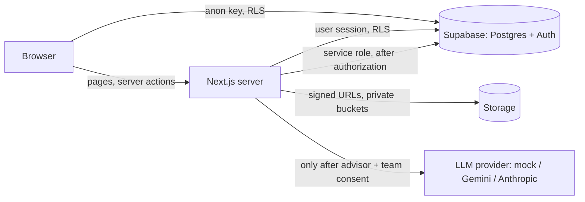

# Architecture

## Synthesis pipeline

1. Upload route validates magic bytes and size, parses (pdfjs / remark / jszip), scans for secrets, stores the file and the extracted text in **private** buckets.
2. `POST /api/projects/[id]/synthesize` checks creator, consent gate (team + advisor), rate limits (per project per hour, per user per day), then builds `ExtractedDoc[]`.
3. `synthesize()` calls the provider (or the mock), validates the JSON with Zod, retries once, chunks large inputs.
4. The server maps file names to ids and runs the evidence check (`matched` / `partial` / `not_found`), then stores `draft_items` as `pending`.
5. The creator reviews every item; `publish_project()` enforces the rules in SQL.

## State rules (SQL functions, `SECURITY DEFINER`)

| Function | Rule |
|---|---|
| `publish_project` | Caller is a creator; advisor consent `approved`; every team member confirmed; no `pending` item; at least one `kept`. Logs `published`. |
| `create_continuation_request` | Project is `published`; caller is not a creator; one open request per requester; tasks are kept `next_task` items of the project. |
| `decide_request` | Creators only; pending only; approved or declined. Logs lineage, notifies the requester. |
| `accept_agreement` | Request approved; caller is a creator or on the requesting team. When both sides have accepted the current version: project `adopted`, adopter becomes a member, lineage `agreement_signed` + `continued`. |
| `request_unlocked` / `has_unlocked` / `can_read_private` | The unlock rule used by RLS: approved **and** acceptances from both sides for `current_agreement_version()`. |
| `issue_advisor_consent` | Creator stores a token **hash** and expiry; earlier pending links are withdrawn. |
| `decide_advisor_consent` | **Service role only.** Single decision, expiry check, optional withdrawal. |
| `check_rate_limit` | Service role only. DB-backed counter. |

## Row Level Security policies

RLS is enabled on every table. Column privileges close gaps RLS cannot express.

| Table | Policy | Who / what |
|---|---|---|
| `profiles` | `profiles_select` | Signed-in users read. |
| | `profiles_update_own` | Own row; columns `full_name, university, faculty, study_program, avatar_url`. |
| `projects` | `projects_select_member` | Creator or member. Public reads go through `public_project_teaser`. |
| | `projects_insert` | `created_by = auth.uid()`. |
| | `projects_update_creator` | Creator, project still editable; only basics columns (status is not updatable). |
| `project_members` | `members_select` | Own row, or creators see their team. Writes only through functions. |
| `advisor_consents` | `consents_select` | Creators; `token_hash` column is not granted. |
| `project_files` | `files_select` | `can_read_private` (creators, or unlocked adopters). No client writes. |
| `synthesis_runs` | `runs_select` | Creators. |
| `draft_items` | `items_select` | `can_read_private`. |
| | `items_insert_creator` | Creator, editable project, `origin = 'creator'`. |
| | `items_update_creator` | Creator, editable project; columns title, description, effort, lesson_type, objective_status, review_status, position. |
| `continuation_requests` | `requests_select` | Creators of the project and the requesting team. Writes only through functions. |
| `agreement_acceptances` | `acceptances_select` | Same as the request. |
| `lineage_events` | `lineage_select` | Project members and the request's team. Insert/update/delete: none for users. A trigger rejects update, delete and truncate for everyone. |
| `notifications` | `notifications_select` / `notifications_update` | Own rows; only `read_at` is updatable. |
| `rate_limit_hits` | none | No client access. |
| Views | `public_project_teaser`, `public_teaser_items`, `public_project_lineage` | Readable by anon. Only published or adopted projects. Items expose a **source label**, never the evidence quote. |
| Storage | none | Both buckets are private. Access only through server-issued signed URLs after an authorization check. |

## Security notes

- There is no advisor role (R5). The old advisor tokens, functions and page were removed; old columns are deprecated.
- Uploads: allowed types by **content**, size limit (`MAX_UPLOAD_MB`), ZIP entry and size limits, traversal rejected, nothing executed.
- ZIPs are never stored: a sanitized tree JSON (tree, README, manifests) is stored instead. `.env`, keys and credentials are skipped and reported.
- File text is passed to the model as data inside `<document>` tags, tags inside the text are neutralized, and the system prompt tells the model to ignore embedded instructions.
- File contents and tokens are never logged.
